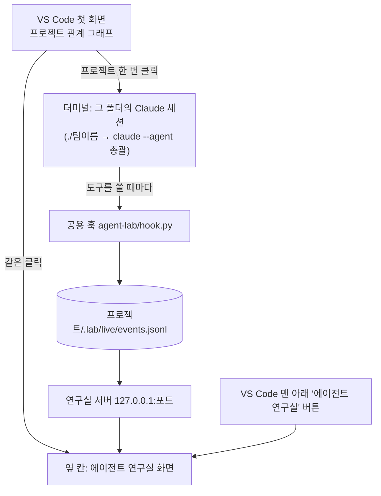

# agents — Claude Code 에이전트 팀을 "보이게" 만드는 개발 환경

여러 프로젝트에서 Claude Code 에이전트 팀(총괄 + 담당들)을 돌릴 때,
**누가 무엇을 맡았고, 어떤 코드·데이터를 거쳐, 어떤 순서로 일하는지**를 VS Code 안에서 실시간으로 보기 위한 도구 모음이다.



## 들어 있는 것

| 폴더 | 무엇 | 설명 |
|---|---|---|
| [`agent-lab/`](agent-lab/) | **에이전트 연구실** | Claude Code 훅 + 로컬 서버 + 화면. 에이전트 카드(캐릭터), 위임 선, 코드·데이터 흐름 상자, 타임라인, 쉬운 문장 활동 기록 |
| [`vscode-extension/`](vscode-extension/) | VS Code 확장 *Project Map Reveal* | 맨 아래 상태 표시줄 "에이전트 연구실" 버튼, 그래프 클릭 → Claude 터미널 + 연구실 열기, 연구실을 VS Code 옆 칸에 띄우기 |
| [`project-graph/`](project-graph/) | 프로젝트 관계 그래프 | 작업공간의 파일·데이터 관계를 정적 분석해 신경망 그래프(HTML)로 그린다. VS Code 첫 화면으로 쓴다 |
| [`templates/`](templates/) | 새 프로젝트용 틀 | 지도(`.lab/map.json`), `labmap`, 팀 실행 스크립트, 훅 설정, 에이전트 정의(총괄·담당·점검) |
| [`docs/setup.md`](docs/setup.md) | 설치 순서 | 처음부터 끝까지 따라 하는 설정 안내와 문제 해결 |
| [`scripts/`](scripts/) | 보조 스크립트 | 캐릭터 그림 가져오기 |

## 빠른 시작

```bash
git clone https://github.com/kjyilj0707/agents ~/agents
~/agents/scripts/fetch-clawd.sh            # 캐릭터 그림(별도 라이선스) 가져오기 — 없으면 건너뛴다
cp -r ~/agents/templates/project/. ~/내프로젝트/   # .lab/map.json, labmap, 실행 스크립트, 훅 예시
```

자세한 순서는 [`docs/setup.md`](docs/setup.md).

## 원칙

- **기록은 최소한만.** 훅은 "누가(에이전트) · 어떤 도구로 · 어느 파일을"만 남긴다. 프롬프트, 도구 결과, 파일 내용, Bash 명령 원문, `.env` 경로는 남기지 않는다.
- **내 컴퓨터 안에서만.** 연구실 서버는 `127.0.0.1`에만 열리고, 그 프로젝트의 지도·기록·화면 파일 밖으로는 나갈 수 없다(경로 탈출 404, 다른 Host 403).
- **작업을 막지 않는다.** 훅은 어떤 오류에도 조용히 끝나고(exit 0) 3초 안에 끝난다.
- **프로젝트별 차이는 지도 하나.** 화면·서버·훅은 공용이고, 프로젝트마다 `.lab/map.json`만 다르다.

## 요구 사항

- macOS (다른 OS는 확인하지 않음), Python 3.10+, Node.js(확장 문법 확인용), VS Code, Claude Code CLI
- 선택: VS Code 확장 [Agent Flow](https://github.com/patoles/agent-flow) — 연구실 지도가 없는 폴더에서 대신 열린다
- 선택: [Clawd on Desk](https://github.com/rullerzhou-afk/clawd-on-desk) — 캐릭터 그림의 출처

## 캐릭터 그림에 대해

연구실 화면의 Clawd 캐릭터 SVG는 [Clawd on Desk](https://github.com/rullerzhou-afk/clawd-on-desk)(AGPL-3.0)의 그림이라 **이 저장소에 넣지 않았다.** `scripts/fetch-clawd.sh`가 설치된 Clawd on Desk 앱에서 복사해 온다. 그림이 없어도 화면은 동작한다(캐릭터 자리만 비어 보인다).

## 라이선스

아직 정하지 않았다. 정하기 전까지는 저작권자의 허락 없이 재배포할 수 없다.
